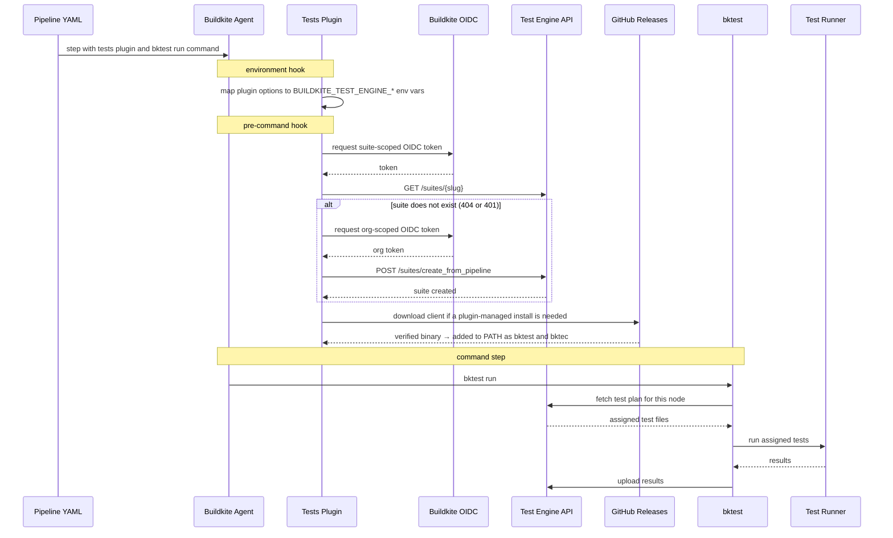

# Tests Buildkite Plugin [](https://buildkite.com/buildkite/plugins-tests)

The Buildkite plugin for automatically parallelising and running your test suites on Buildkite. It splits your tests across parallel jobs so they finish faster, and handles all the setup for you. The splitting and running is done by [bktest](https://github.com/buildkite/bktest), the client this plugin installs and configures for you.

Behind the scenes, the plugin downloads the client, requests an [OIDC](https://buildkite.com/docs/pipelines/security/oidc) token, ensures your [test suite](https://buildkite.com/docs/test-engine/test-suites) exists, and exports the environment variables bktest expects, so you do not have to install the client, set up authentication, or create your test suite by hand. It works with every test runner that bktest supports, including RSpec, Jest, pytest, and Go test.

## Example

```yaml
steps:
  - label: "RSpec"
    command: bktest run
    plugins:
      - tests#v1.3.0:
          test-runner: rspec
          result-path: tmp/rspec-result.json
    parallelism: 2
```

Use `bktest run` to run tests or `bktest plan` to create a test plan. The plugin sets up the environment but does not run the command for you.

> **Compatibility:** From Tests plugin v1.3.0 onward, plugin-managed installs provide both `bktest` and `bktec`. Existing pipelines can keep using `bktec`. If your agent already has `bktec` but not `bktest`, keep using `bktec` or set [`client-version`](#client-version-optional-string) to request a plugin-managed install.

If the `suite-slug` attribute is not set, the plugin uses the pipeline slug as the test suite slug. If the test suite does not exist yet, the plugin creates it from the pipeline on the first run.

## Examples by runner

### Jest

```yaml
steps:
  - label: "Jest"
    command: bktest run
    plugins:
      - tests#v1.3.0:
          test-runner: jest
          result-path: jest-results.json
    parallelism: 4
```

### pytest

```yaml
steps:
  - label: "Run tests"
    command: bktest run
    parallelism: 5
    plugins:
      - tests#v1.3.0:
          test-runner: pytest
```

### Go test

```yaml
steps:
  - label: "Go test"
    command: bktest run
    plugins:
      - tests#v1.3.0:
          test-runner: gotest
          result-path: gotest-results.xml
    parallelism: 4
```

### Dynamic parallelism

To let bktest choose the number of partitions for a target run time, run `bktest plan` in a planning step with the `--pipeline-upload` flag, pointing at a pipeline template you supply. `bktest plan` uploads a follow-up step that runs the test plan. `--pipeline-upload` is passed directly to `bktest` in `command:` because it is not exposed as a plugin option (see [Unsupported bktest flags](#unsupported-bktest-flags)).

```yaml
steps:
  - label: "Plan RSpec"
    key: rspec-plan
    command: bktest plan --pipeline-upload .buildkite/rspec-template.yml
    plugins:
      - tests#v1.3.0:
          test-runner: rspec
          result-path: tmp/rspec-result.json
          max-parallelism: 10
          target-time: 4m30s
```

The pipeline template at `.buildkite/rspec-template.yml` contains the run step:

```yaml
steps:
  - label: "RSpec"
    key: rspec-run
    depends_on: rspec-plan
    command: bktest run --plan-identifier ${BUILDKITE_TEST_ENGINE_PLAN_IDENTIFIER}
    parallelism: ${BUILDKITE_TEST_ENGINE_PARALLELISM}
    plugins:
      - tests#v1.3.0:
          test-runner: rspec
          result-path: tmp/rspec-result.json
```

### Manual test selection

To run only the tests you choose, set `manual-selection-command` to a command that prints them, one per line. The plugin exports its output as `BUILDKITE_TEST_ENGINE_SELECTION_SELECTORS`, which `bktest plan` and `bktest run` read as the tests to select. Requires Test Engine Client 3.3.0 or later.

```yaml
steps:
  - label: "Select tests"
    key: select-tests
    if: build.pull_request.id != null
    command: bktest plan --pipeline-upload .buildkite/rspec-template.yml
    plugins:
      - tests#v1.3.0:
          test-runner: rspec
          result-path: tmp/rspec-result.json
          max-parallelism: 10
          manual-selection-command: .buildkite/select-tests.sh
```

Here `select-tests.sh` might print the changed specs with `git diff --name-only origin/main...HEAD -- '*_spec.rb'`, and `rspec-template.yml` is the run step from [Dynamic parallelism](#dynamic-parallelism) with `depends_on: select-tests`.

- If the command prints no tests, the plan selects none and, with `max-parallelism` above 1, `bktest plan` uploads no run step. The step fails if the command fails.
- To run the step in Docker, list `BUILDKITE_TEST_ENGINE_SELECTION_SELECTORS` under the Docker plugin's `environment:`. `propagate-environment` only passes variables the plugin writes to `BUILDKITE_ENV_FILE`, and the selectors aren't written there because that file can't hold multi-line values. Without it, bktest sends no selectors and the step fails.

### Docker

When the test command runs inside a Docker container, the plugin sets `BUILDKITE_TEST_ENGINE_CLIENT_PATH` to the client path on the host. Mount it as `/usr/local/bin/bktest` to run `bktest` inside the container. Set `propagate-environment: true` on the Docker plugin so the container picks up the `BUILDKITE_TEST_ENGINE_*` variables. Set `client-os` and `client-arch` when the host operating system or architecture differs from the container.

```yaml
steps:
  - label: "Jest"
    command: bktest run
    plugins:
      - tests#v1.3.0:
          test-runner: jest
          client-os: linux
          result-path: jest-results.json
      - docker#v5.13.0:
          image: node:24-slim
          expand-volume-vars: true
          volumes:
            - "$$BUILDKITE_TEST_ENGINE_CLIENT_PATH:/usr/local/bin/bktest"
          propagate-environment: true
```

## Configuration

### bktest options

These options map directly to client flags or environment variables. For the full reference, see the [bktest repository](https://github.com/buildkite/bktest).

#### `test-runner` (required, string)

Any runner supported by bktest, for example `rspec`, `jest`, `pytest`, or `gotest`.

#### `test-cmd` (required for `custom` and `pytest-pants` runners, string)

Command to run tests.

#### `result-path` (string)

Path to the test runner's output file. Required for all runners except `cypress`, `pytest`, `pytest-pants`, and `custom`.

#### `suite-slug` (optional, string)

Test suite slug. Defaults to the pipeline slug.

#### `test-file-pattern` (required for `custom` runner, string)

Glob pattern for test files.

#### `test-file-exclude-pattern` (optional, string)

Exclude test files matching this pattern.

#### `tag-filters` (optional, string)

Filter tests by tag. Currently only supported by pytest.

#### `files` (optional, string)

Path to a file that lists test files to run, one per line.

#### `retry-count` (optional, integer)

Number of times to retry failing tests.

#### `retry-cmd` (optional, string)

Command to run when retrying failed tests. Defaults to `test-cmd`.

#### `disable-retry-for-muted-test` (optional, boolean)

Disable retry for muted tests.

#### `split-by-example` (optional, boolean)

Enable example-level splitting. Not supported by every runner.

#### `location-prefix` (optional, string)

Prefix to prepend to test file paths when requesting a test plan.

#### `selection-strategy` (optional, string)

Test selection strategy for the test plan. `manual` is currently the only available strategy: it runs only the tests printed by [`manual-selection-command`](#manual-selection-command-optional-string). Defaults to `manual` when `manual-selection-command` is set, so you don't need to set both. See [Manual test selection](#manual-test-selection).

#### `max-parallelism` (optional, integer)

Maximum parallelism for dynamic test plans. Used with `bktest plan`.

#### `target-time` (optional, string)

Desired target time for the test suite, for example `4m30s`. Must be used with `max-parallelism`.

#### `plan-identifier` (optional, string)

Test plan identifier created by `bktest plan`. Set automatically in dynamic mode; can be set manually for static mode.

#### `fail-on-no-tests` (optional, boolean)

Exit with an error if no tests are assigned to this node.

#### `upload-results` (optional, boolean)

Upload test results to your test suite. Default: `true`. Set to `false` if you use the [test collectors](https://buildkite.com/docs/test-engine/test-collection/) for richer data collection, or if you want to handle the upload yourself.

Requires Test Engine Client 2.7.0 or later.

#### `tags` (optional, array of strings)

Tags to attach to the uploaded test results. Each tag is a `key=value` string.

```yaml
plugins:
  - tests#v1.3.0:
      test-runner: rspec
      tags:
        - "language.version=3.3"
        - "os=linux"
```

#### `debug-enabled` (optional, boolean)

Enable verbose output.

### Plugin options

These options control plugin behavior and are not passed to bktest.

#### `install-client` (optional, boolean)

Default: `true`. From plugin v1.3.0, a plugin-managed install puts both `bktest` and `bktec` on `PATH`, even for cached binaries and older client pins. `BUILDKITE_TEST_ENGINE_CLIENT_PATH` still uses the `bktec` path. Plugin v1.2.0 and earlier install only the `bktec` name.

If `bktec` is already on `PATH` and no `client-version`, `client-os`, or `client-arch` is set, the plugin uses that binary without adding a `bktest` alias. Set `install-client: false` to manage the install yourself; make sure the command name you invoke is available in the step's environment.

#### `client-os` (optional, string)

Target OS for the downloaded binary, for example `linux` or `darwin`. Defaults to the host OS. Useful when the host and a Docker container run different operating systems.

#### `client-arch` (optional, string)

Target architecture for the downloaded binary, for example `amd64` or `arm64`. Defaults to the host architecture.

#### `client-version` (optional, string)

Client version to download, for example `3.6.0` or `3.1.0-rc.1`. An optional leading `v` is accepted. If unset, the plugin finds the latest CLI version using the [compatibility release channel](https://github.com/buildkite/test-engine-client/releases/latest), since the canonical repository also publishes test collectors.

The plugin downloads CLI versions `3.6.0` and later, as well as `3.6.0-rc.3`, from [buildkite/bktest](https://github.com/buildkite/bktest/releases). Older pins still download from [buildkite/test-engine-client](https://github.com/buildkite/test-engine-client/releases).

If you pin a client older than `3.6.0`, you can keep calling `bktec`. Plugin v1.3.0 also provides `bktest` for plugin-managed installs of those versions. Use `bktec` if you're on plugin v1.2.0 or earlier and rely on the plugin to install the client, or if your own install only provides `bktec`.

#### `manual-selection-command` (optional, string)

Command that prints the tests to run, one per line. Its output is exported as `BUILDKITE_TEST_ENGINE_SELECTION_SELECTORS`. Skipped, with a warning, when `selection-strategy` is set to anything other than `manual`. See [Manual test selection](#manual-test-selection).

#### `oidc-lifetime` (optional, integer)

Lifetime in seconds for the suite-scoped OIDC token exported to the client and test collectors. Default: `7200` (2 hours), matching the client's default.

The token must cover setup, tests, and uploads. It is issued during `pre-command` and is not refreshed. Uploads after it expires fail, but the job can still pass.

Buildkite's [default maximum OIDC lifetime](https://buildkite.com/docs/platform/limits#platform-and-organization-level-limits) is 2 hours. If the value exceeds your organization's limit, the token request fails and the job stops before tests run.

## How it works



## Unsupported bktest flags

A small number of bktest flags cannot be set through environment variables, so the plugin intentionally does not expose them as options. To use any of these, pass them directly to `bktest` in your step's `command:`.

| Flag                | Command                    | Notes                                               |
| ------------------- | -------------------------- | --------------------------------------------------- |
| `--selection-param` | `run`, `plan`              | Not needed for manual selection                     |
| `--metadata`        | `run`, `plan`              | Preview selection                                   |
| `--json`            | `plan`                     | Print the plan as JSON to stdout                    |
| `--pipeline-upload` | `plan`                     | Upload a follow-up pipeline step that runs the plan |
| `--output`          | `backfill-commit-metadata` | Write tarball locally                               |
| `--upload`          | `backfill-commit-metadata` | Upload an existing tarball                          |
| `--version`         | Global                     | No environment variable needed                      |

## Contributing

Bug reports and pull requests are welcome on GitHub at https://github.com/buildkite-plugins/tests-buildkite-plugin.

## License

MIT (see [LICENSE.txt](LICENSE.txt)).
